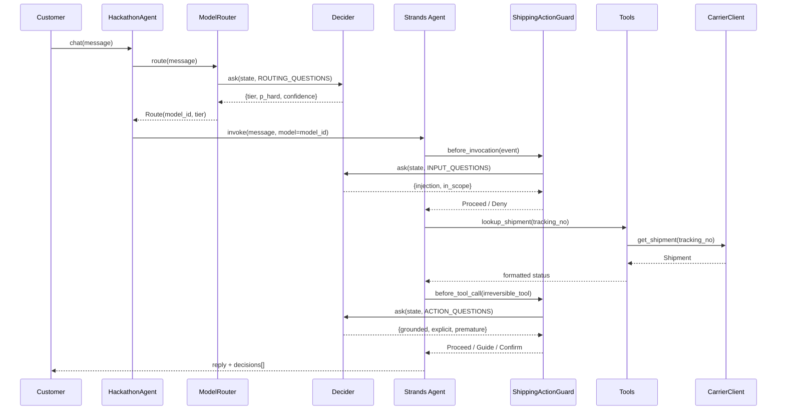

# Design Document

## Overview

The shipping-tracking-agent is a natural-language customer-support agent for an online store. It lets customers check shipment status, understand delivery exceptions, and request address changes through a conversational chat interface — without needing to call human support.

The agent is built on [Strands Agents SDK](https://strandsagents.com) and uses **Strands Decider 2B** with the **model routing** pattern to minimise cost: simple, deterministic queries (status lookups, ETA checks) go to a fast, cheap LLM; complex or high-stakes interactions (lost packages, damage claims, address changes, irreversible actions) are escalated to a smarter model. A guardrail intervention prevents the agent from taking irreversible actions (carrier investigations, replacements, refunds) without verified customer intent and explicit confirmation.

The carrier integration is pluggable: EasyPost, ShipEngine, or AfterShip is selected at startup via environment variables, and a provider-registry pattern allows additional carriers to be added without touching existing code. The finished agent deploys on **Amazon Bedrock AgentCore Runtime** using the same `deploy/app/agent/main.py` entry point pattern already in the kit.

Key design goals:
- Reuse the existing `decider_kit` patterns (model routing, guardrails, context memory) without forking them.
- Keep all carrier-specific logic behind a single `CarrierClient` abstract interface so the agent layer never knows which carrier it is talking to.
- Maintain the `HackathonAgent.chat(message, session_id, images)` contract so the demo UI, benchmark, and AgentCore entry point continue to work unchanged.

---

## Architecture

### Component Diagram

```mermaid
flowchart TD
    UI["Demo UI\n(FastAPI + static HTML)"]
    AC["AgentCore Runtime\n(deploy/app/agent/main.py)"]
    HA["HackathonAgent\n(agent/agent.py)"]
    MR["ModelRouter\n(decider_kit/patterns/model_routing.py)"]
    GR["ShippingActionGuard\n(agent/decision.py)"]
    ST["Strands Agent\n(strands.Agent)"]
    DEC["Strands Decider 2B\n(decider_kit/client.py)"]
    TOOLS["Carrier Tools\n(agent/tools.py)"]
    CC["CarrierClient\n(agent/carrier.py)"]
    MEM["SessionStore\n(agent/session.py)"]
    CACHE["ShipmentCache\n(5-min TTL)"]
    CAPI["Carrier API\n(EasyPost / ShipEngine / AfterShip)"]
    BEDROCK["Amazon Bedrock\n(Fast_Model + Smart_Model)"]

    UI -->|POST /api/chat| HA
    AC -->|invoke| HA
    HA -->|route(message)| MR
    MR -->|ask()| DEC
    MR -->|model_id| ST
    HA -->|chat turn| ST
    ST -->|before_tool_call| GR
    GR -->|ask()| DEC
    ST -->|call tool| TOOLS
    TOOLS -->|lookup / change| CC
    CC -->|HTTP| CAPI
    TOOLS -->|read/write| MEM
    MEM --- CACHE
    ST -->|generate reply| BEDROCK
```

### Request Flow



---

## Components and Interfaces

### `agent/agent.py` — `ShippingTrackingAgent`

The top-level agent class. Mirrors the kit's `HackathonAgent` interface so the demo UI and AgentCore entry point require no changes.

```python
class ShippingTrackingAgent:
    def __init__(
        self,
        decider: Decider | None = None,
        model_id: str | None = None,
        carrier: CarrierClient | None = None,
    ): ...

    def chat(
        self,
        message: str,
        session_id: str = "default",
        images: list[Any] | None = None,
    ) -> dict[str, Any]:
        """Returns {"reply", "decisions", "model_id", "latency_ms", "agent", "tier"}."""
        ...
```

Internals per turn:
1. Retrieve or create the `SessionStore` for `session_id`.
2. Call `ModelRouter.route(message)` → `Route`.
3. Build a `strands.Agent` with `agent_model(route.model_id)`, the carrier tools, and `ShippingActionGuard` as the intervention handler.
4. Invoke the agent; strip `<thinking>` blocks from the reply.
5. Return the reply plus the combined decision log from both the router and the guard.

### `agent/carrier.py` — Carrier abstraction

```python
class CarrierClient(ABC):
    @abstractmethod
    def get_shipment(self, identifier: str) -> Shipment | None: ...

    @abstractmethod
    def change_address(self, tracking_no: str, new_address: Address) -> AddressChangeResult: ...

class EasyPostClient(CarrierClient): ...
class ShipEngineClient(CarrierClient): ...
class AfterShipClient(CarrierClient): ...

_REGISTRY: dict[str, type[CarrierClient]] = {
    "easypost": EasyPostClient,
    "shipengine": ShipEngineClient,
    "aftership": AfterShipClient,
}

def register_carrier(name: str, cls: type[CarrierClient]) -> None:
    """Add a new provider without changing existing code (Requirement 5.5)."""
    _REGISTRY[name.lower()] = cls

def carrier_from_env() -> CarrierClient:
    """Reads CARRIER_PROVIDER and CARRIER_API_KEY; raises on missing key (Requirement 5.4)."""
    ...
```

**Design rationale:** The registry pattern satisfies Requirement 5.5 (new providers need no changes to existing carrier files). The factory `carrier_from_env()` centralises env-variable validation so the rest of the code never touches `os.environ` for carrier config.

### `agent/tools.py` — Strands tools

All tools are decorated with `@tool` and have clear one-line docstrings (used by `ToolSelector` if added later).

| Tool | Purpose | Reversible |
|---|---|---|
| `lookup_shipment(identifier)` | Query Carrier_API; populate session cache | Yes |
| `list_cached_shipments()` | Return all tracking numbers in the current session | Yes |
| `report_damage(order_id, description)` | Validate and record a damage report | Yes |
| `initiate_carrier_investigation(tracking_no)` | Open a lost-package claim | **No** |
| `request_replacement(order_id)` | Trigger replacement fulfilment | **No** |
| `initiate_refund(order_id, amount)` | Issue a refund | **No** |
| `request_address_change(tracking_no, new_address)` | Submit address redirect to carrier | **No** |

Irreversible tools are the guarded set in `ShippingActionGuard`.

### `agent/session.py` — `SessionStore`

Manages per-session state as described in Requirement 6.

```python
@dataclass
class CachedShipment:
    shipment: Shipment
    fetched_at: float   # time.time()

class SessionStore:
    MAX_IDS = 20
    CACHE_TTL = 300   # seconds (5 minutes, Requirement 6.2)
    IDLE_TIMEOUT = 1800  # seconds (30 minutes, Requirement 6.4)

    def add_identifier(self, identifier: str) -> None: ...
    def get_shipment(self, identifier: str) -> Shipment | None: ...
    def put_shipment(self, identifier: str, shipment: Shipment) -> None: ...
    def needs_refresh(self, identifier: str) -> bool: ...
    def touch(self) -> None: ...
    def is_expired(self) -> bool: ...
    def clear(self) -> None: ...
```

A global `_SESSIONS: dict[str, SessionStore]` dictionary is managed by `HackathonAgent`. A background-cleanup call (`_evict_expired()`) runs at the start of each `chat()` call to discard idle sessions (Requirement 6.4).

### `agent/decision.py` — `ShippingActionGuard`

Extends the kit's guardrail pattern. Checks three questions before any irreversible tool call, using the same `InterventionHandler` interface from `strands.interventions`.

```python
GUARDED_TOOLS = {
    "initiate_carrier_investigation",
    "request_replacement",
    "initiate_refund",
    "request_address_change",
}

QUESTIONS = {
    "args_grounded": Decider.noul(...),   # args come from customer or prior lookup
    "explicit_request": Decider.noul(...), # customer clearly asked, not just asked about it
    "premature": Decider.noul(...),        # details confirmed; not too early to act
}

class ShippingActionGuard(InterventionHandler):
    def before_invocation(self, event, **kwargs) -> Proceed: ...
    def before_tool_call(self, event, **kwargs) -> Proceed | Guide | Confirm | Deny: ...
```

The logic mirrors `OrderActionGuard` in the kit example: grounded + explicit + not-premature = `Proceed`; otherwise `Guide` (with actionable feedback) or `Confirm` (when the decider is in the unsure band).

### Model Routing (reused from `decider_kit`)

`ModelRouter` from `decider_kit.patterns.model_routing` is used directly. The routing questions classify a shipping query as `simple` (status check, ETA) or implicitly `complex` (exception, address change, damage, lost package) by checking the `hard` noul question and the `tier` choice.

For shipping, the tiers map to:
- `small` → `BEDROCK_SMALL_MODEL_ID` (Amazon Nova Micro): ETAs, basic status
- `medium` → `BEDROCK_MEDIUM_MODEL_ID` (Amazon Nova Lite): carrier explanations
- `large` → `BEDROCK_LARGE_MODEL_ID` / `BEDROCK_MODEL_ID` (Amazon Nova Pro): loss claims, address changes, damage disputes

Confidence below 0.5 always routes to `large` (Requirement 2.4), matching the existing `ModelRouter` default `unsure_to="large"`.

---

## Data Models

### `Shipment`

```python
@dataclass
class TrackingEvent:
    description: str
    location: str
    timestamp: datetime

@dataclass
class Shipment:
    tracking_number: str
    carrier: str
    status: str                          # e.g. "in_transit", "delivered", "exception"
    estimated_delivery: datetime | None
    events: list[TrackingEvent]
    raw: dict[str, Any]                  # provider-specific payload (never exposed to customer)

    @property
    def latest_event(self) -> TrackingEvent | None: ...

    @property
    def is_exception(self) -> bool: ...

    def days_since_estimated_delivery(self) -> int | None:
        """Returns None if ETA is unknown; used to detect lost packages (> 7 days, Req 3.3)."""
        ...
```

### `Address`

```python
@dataclass
class Address:
    street: str
    city: str
    postal_code: str
    country: str
    state: str | None = None
    name: str | None = None

    def is_complete(self) -> bool:
        """All required fields (street, city, postal_code, country) are non-empty (Req 4.6)."""
        return all([self.street, self.city, self.postal_code, self.country])
```

### `AddressChangeResult`

```python
@dataclass
class AddressChangeResult:
    success: bool
    updated_address: Address | None
    revised_eta: datetime | None
    error_reason: str | None   # populated when success=False
```

### `RoutingDecision` (log entry, Requirement 7.2)

```python
@dataclass
class RoutingDecision:
    query_category: str        # "simple" | "complex"
    confidence: float          # 0.0 – 1.0
    selected_model_id: str
    latency_ms: int            # non-negative
```

The `decisions` list in every `chat()` response collects both `ModelRouter` log entries and `ShippingActionGuard` log entries, serialised to plain dicts to match the existing demo UI contract.

### Environment Variables

| Variable | Default | Purpose |
|---|---|---|
| `CARRIER_PROVIDER` | `easypost` | Active carrier; `easypost`, `shipengine`, `aftership` |
| `CARRIER_API_KEY` | *(required)* | API key — never logged (Req 5.6) |
| `BEDROCK_MODEL_ID` | `us.amazon.nova-pro-v1:0` | Default / Smart_Model |
| `BEDROCK_SMALL_MODEL_ID` | `us.amazon.nova-micro-v1:0` | Fast_Model |
| `BEDROCK_LARGE_MODEL_ID` | same as `BEDROCK_MODEL_ID` | Smart_Model for complex routing |
| `DECIDER_MODE` | `local` | `local` / `ugmdu` / `custom` |
| `DECIDER_API_KEY` | *(empty)* | Key for ugmdu or custom decider |
| `AWS_REGION` | `us-east-1` | Bedrock and AgentCore region |

---

## Correctness Properties

*A property is a characteristic or behavior that should hold true across all valid executions of a system — essentially, a formal statement about what the system should do. Properties serve as the bridge between human-readable specifications and machine-verifiable correctness guarantees.*

### Property 1: Model routing confidence fallback

*For any* customer message and any routing label (`simple` or `complex`) returned by the Decider, if the confidence score is strictly below 0.5, the agent SHALL select the Smart_Model's `model_id`, regardless of the label.

**Validates: Requirements 2.4**

### Property 2: Routing decision log completeness

*For any* processed customer message, every entry in the `decisions` list of the chat response SHALL contain a `query_category` that is `"simple"` or `"complex"`, a `confidence` value in the closed interval [0.0, 1.0], a non-empty `selected_model_id` string, and a non-negative integer `latency_ms`.

**Validates: Requirements 2.6, 7.1, 7.2**

### Property 3: Session identifier cap and recency

*For any* sequence of identifier additions to a `SessionStore`, the store SHALL never hold more than 20 identifiers, and when additions exceed 20 the retained set SHALL equal exactly the 20 most recently added identifiers.

**Validates: Requirements 6.1**

### Property 4: Shipment cache TTL boundary

*For any* `CachedShipment` whose `fetched_at` timestamp is at most 299 seconds in the past, `needs_refresh()` SHALL return `False`; for any whose `fetched_at` is at least 300 seconds in the past, `needs_refresh()` SHALL return `True`.

**Validates: Requirements 6.2**

### Property 5: New session starts empty

*For any* two distinct session IDs, data added to the first session SHALL not appear in the `SessionStore` created for the second session.

**Validates: Requirements 6.5**

### Property 6: Address completeness validation

*For any* `Address` object, `is_complete()` SHALL return `True` if and only if `street`, `city`, `postal_code`, and `country` are all non-empty strings; it SHALL return `False` if any of those four fields is absent or empty.

**Validates: Requirements 4.6**

### Property 7: CARRIER_API_KEY never in output

*For any* string value of `CARRIER_API_KEY`, no log entry dict, API response dict, or exception message produced by the agent SHALL contain that string value as a substring.

**Validates: Requirements 5.6**

### Property 8: Shipment data round-trip

*For any* valid `Shipment` object, serialising it to a plain dict and deserialising the dict back SHALL produce a `Shipment` equal to the original in `tracking_number`, `status`, `carrier`, `estimated_delivery`, and `events`.

**Validates: Requirements 1.1, 1.2**

### Property 9: Damage description length enforcement

*For any* string submitted as a damage description, the `report_damage` tool SHALL reject the submission (return an error) if the string is empty or longer than 1000 characters, and SHALL accept it if its length is between 1 and 1000 characters inclusive.

**Validates: Requirements 3.4**

---

## Error Handling

### Carrier API unavailability (Requirements 1.5, 4.7)

`CarrierClient` implementations wrap all HTTP calls in a try/except that catches `requests.Timeout` (timeout ≥ 10 s for address changes per Req 4.7, default 10 s for lookups), `requests.ConnectionError`, and HTTP 5xx responses. The tool layer converts these to structured `{"error": ..., "retry_after_minutes": 15}` dicts so the LLM can form an appropriate natural-language reply without leaking stack traces.

### Carrier API returns no shipment (Requirement 1.4)

`get_shipment()` returns `None` when the carrier API responds with a not-found result. The `lookup_shipment` tool converts this to `{"error": "tracking_not_found", "identifier": ...}`. The system prompt instructs the agent to respond with a verification prompt in this case.

### Decider unavailability (Requirement 2.5)

`ModelRouter.route()` wraps `Decider.ask()` in a try/except for `DeciderError`. On failure, it returns a `Route` with `tier="large"` (Smart_Model), `p_hard=1.0`, `confidence=0.0`, and `reason="decider_unavailable"`, and appends a log entry recording the failure reason. The agent continues; no customer-facing error is raised.

`ShippingActionGuard.before_tool_call()` also catches `DeciderError`: on failure, irreversible tool calls fall back to `Confirm` (require human approval from the demo UI) rather than `Proceed`, so safety is preserved.

### Carrier API key missing (Requirement 5.4)

`carrier_from_env()` raises `CarrierConfigError` (a subclass of `RuntimeError`) at agent startup if `CARRIER_API_KEY` is absent or empty. The error message says the key is missing without printing its value. `HackathonAgent.__init__` catches this and stores the error; `chat()` returns `{"error": "carrier_not_configured"}` immediately, without forwarding the message to the LLM.

### Address change timeout (Requirement 4.7)

`CarrierClient.change_address()` is called with a 10-second timeout. On `Timeout`, the tool returns `{"error": "address_change_timeout"}`. The agent's system prompt instructs it to notify the customer and suggest retrying or contacting the carrier directly.

### Session expiry (Requirement 6.4)

`_evict_expired()` is called at the start of each `chat()`. Sessions idle for more than 30 minutes are removed from `_SESSIONS`; their `SessionStore.clear()` is called first to drop all retained shipment and identifier data.

### Input guardrail — injection / out-of-scope

`ShippingActionGuard.before_invocation()` inherits the input-check logic from `DeciderGuardrail` (using `scope="shipping and order-tracking support"`). Injection is `Deny`ed; out-of-scope requests are `Guide`d to a polite redirect.

---

## Testing Strategy

### Unit Tests

Unit tests cover pure functions and isolated components with no network calls:

- `Address.is_complete()` — valid and invalid address combinations
- `SessionStore` — identifier cap (>20), TTL logic, expiry after 30 min idle, no cross-session carry-over
- `carrier_from_env()` — missing key raises `CarrierConfigError`; unrecognised provider uses EasyPost default; `CARRIER_API_KEY` absent emits the correct error message
- `Shipment.days_since_estimated_delivery()` — correct delta for past/future/unknown ETAs, lost-package threshold (>7 days)
- `Shipment.is_exception` — correctly identifies exception statuses
- `ShippingActionGuard` log entries — correct keys and value types present for each verdict

### Property-Based Tests

Property-based tests use **[Hypothesis](https://hypothesis.readthedocs.io/)** (minimum 100 iterations each).

Each test is tagged with a comment: `# Feature: shipping-tracking-agent, Property N: <property_text>`

**Property 1 — Model routing confidence fallback**
Generate routing labels (`simple` / `complex`) and confidence values in [0.0, 0.5). Mock `Decider.ask` to return those values. Assert that `ModelRouter` always selects the `large` tier's `model_id`.
`# Feature: shipping-tracking-agent, Property 1: confidence < 0.5 always routes to Smart_Model`

**Property 2 — Routing decision log completeness**
Generate arbitrary short strings as messages; mock `Decider.ask` with varied routing outputs. Assert every entry in `decisions` has `0.0 <= confidence <= 1.0`, `latency_ms >= 0`, and `selected_model_id` is a non-empty string.
`# Feature: shipping-tracking-agent, Property 2: every decisions entry is structurally complete`

**Property 3 — Session identifier cap and recency**
Generate lists of 1–50 identifier strings. Add them all to a fresh `SessionStore`. Assert `len(store) <= 20` and the retained identifiers equal the last 20 added.
`# Feature: shipping-tracking-agent, Property 3: session cap preserves most-recent identifiers`

**Property 4 — Shipment cache TTL boundary**
Generate integer age offsets in seconds (0–600). Set `fetched_at = time.time() - offset`. Assert `needs_refresh()` is `False` for `offset < 300` and `True` for `offset >= 300`.
`# Feature: shipping-tracking-agent, Property 4: cache TTL boundary is exactly 300 seconds`

**Property 5 — New session starts empty**
Generate pairs of distinct session IDs. Populate the first session with identifiers and shipments. Create a new `SessionStore` for the second ID. Assert it contains no identifiers and no cached shipments.
`# Feature: shipping-tracking-agent, Property 5: new session contains no data from any prior session`

**Property 6 — Address completeness validation**
Generate `Address` instances using Hypothesis strategies with arbitrary strings (including empty) for each field. Assert `is_complete()` returns `True` iff all four required fields (`street`, `city`, `postal_code`, `country`) are non-empty.
`# Feature: shipping-tracking-agent, Property 6: address validity matches required-field presence`

**Property 7 — CARRIER_API_KEY never in output**
Generate arbitrary printable strings as `CARRIER_API_KEY`. Mock the carrier and force error and log paths. Assert the key value does not appear as a substring in any dict value, log entry, or raised exception message.
`# Feature: shipping-tracking-agent, Property 7: CARRIER_API_KEY is never exposed in any output`

**Property 8 — Shipment data round-trip**
Generate `Shipment` instances with arbitrary tracking numbers, statuses, carriers, optional ETAs, and event lists. Serialise to a plain `dict` and deserialise back. Assert structural equality.
`# Feature: shipping-tracking-agent, Property 8: Shipment serialisation round-trip is identity`

**Property 9 — Damage description length enforcement**
Generate strings of length 0–1500. Assert that `report_damage` accepts lengths 1–1000 and rejects 0 and lengths > 1000.
`# Feature: shipping-tracking-agent, Property 9: damage description enforces 1–1000 char bounds`

### Integration Tests

Integration tests run against a real carrier sandbox (or a recorded-response VCR cassette) and a local `strands-decider serve`:

- Carrier lookup returns a well-formed `Shipment` for a known test tracking number
- Address change succeeds for a carrier that supports it in sandbox mode
- `ModelRouter` makes a live Decider call and returns a valid `Route`
- End-to-end `chat("Track my package A1002")` returns a reply containing a status string

### Demo UI Smoke Test

- `GET /api/info` returns `agent`, `llm`, `decider`, `target` keys
- `POST /api/chat {"message": "Where is my package?", "session_id": "test"}` returns `reply` and `decisions` keys
- `POST /api/reset` clears the agent singleton

### Test Configuration

```
# pytest.ini (additions)
[pytest]
addopts = --hypothesis-seed=0
filterwarnings = ignore::DeprecationWarning
```

```python
# conftest.py
from hypothesis import settings as hs
hs.register_profile("ci", max_examples=200)
hs.register_profile("dev", max_examples=50)
```
