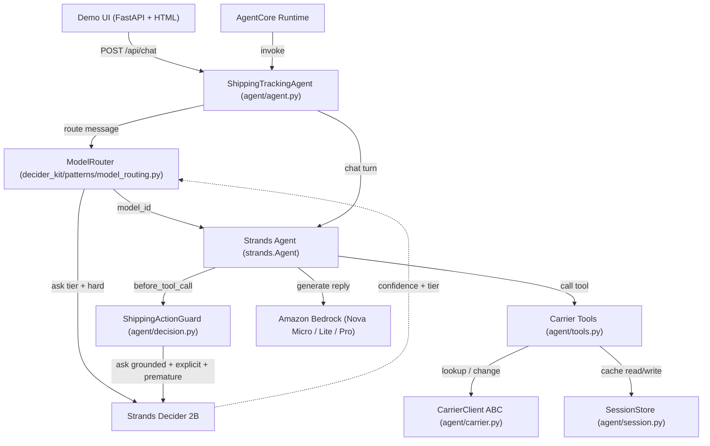

# Shipping and Tracking Support Agent with Strands Decider 2B Model Routing

By Vijay

Every time a customer asks "where is my package?", a support agent faces a fork: is this a
simple status lookup that a cheap, fast model can handle in under a second, or is it a lost
package dispute that needs careful, capable reasoning? Getting that fork wrong in either
direction costs money or quality. This project solves it systematically with Strands Decider 2B.

The Shipping and Tracking Support Agent is a natural-language customer-support agent for online
stores. It handles shipment status lookups, delivery exceptions, damage reports, address change
requests, and carrier investigations through a conversational chat interface -- without customers
needing to call support. The decision that sits at its centre: which model tier does this message
need?

## The problem

Customer support for shipping has a wide range of query complexity. "Is my parcel delivered?"
takes one carrier API call and a short reply. "My package shows no scan for 10 days, I need an
investigation and a refund" requires multi-step reasoning, careful handling, and explicit customer
confirmation before anything irreversible happens. Sending every message to the most capable model
is safe but expensive. Sending every message to the cheapest model produces poor outcomes for the
hard cases.

A static routing rule -- "if the word 'lost' appears, use the large model" -- breaks quickly.
Real customers write "it never showed up" or "I have been waiting ages." What you need is a
model that reads language and returns a calibrated confidence score the code can branch on.
That is exactly what Strands Decider 2B provides.

## The solution

The agent classifies each incoming message once, before choosing a model. Strands Decider 2B
reads the message and answers two typed questions:

- **hard** (noul): does answering this correctly need careful multi-step reasoning?
- **tier** (choice): which model size is sufficient -- small, medium, or large?

The classification returns a probability, not just a label, so low-confidence cases default
automatically to the large model rather than guessing. Once the tier is chosen, a Strands Agent
is built with the corresponding Amazon Bedrock model and the carrier tools.

A second Decider call guards every irreversible action. Before initiating a carrier investigation,
requesting a replacement, issuing a refund, or submitting an address change, the agent checks:

- Are the arguments grounded in what the customer actually said?
- Did the customer explicitly ask for this action (not just ask about it)?
- Is it premature to act now, or should the agent confirm first?

If confidence is low, the action is held for a human. If the arguments are invented, the agent
is guided back to ask. This two-layer approach -- routing first, guardrail second -- keeps costs
low for the 80% of simple queries while preserving safety for the 20% that matter most.

## Architecture

The system has five logical layers.



**ShippingTrackingAgent** is the top-level class. It holds the Decider, ModelRouter,
CarrierClient, and a session registry. For each chat turn it evicts expired sessions,
routes the message via ModelRouter, builds a Strands Agent with the routed model,
injects the session context into the tools via a ContextVar, invokes the agent,
and returns a structured response including a `decisions` list of every Decider call made.

**ModelRouter** (reused unchanged from `decider_kit/patterns/model_routing.py`) makes one
Decider call per message. It maps the response to Amazon Nova Micro (simple lookups),
Nova Lite (explanations), or Nova Pro (complex, irreversible, multi-step). Any response
with confidence below 0.65 falls through to Nova Pro.

**ShippingActionGuard** (agent/decision.py) implements Strands Agents' InterventionHandler
interface. It fires before every tool call that is in the GUARDED_TOOLS set and makes one
Decider call to evaluate the three questions above. The outcome is one of Proceed, Guide,
Confirm, or Deny. If the Decider is unreachable, it falls back to Confirm rather than
Proceed -- safety is preserved even when the decision model is offline.

**CarrierClient** is an abstract base class with a provider registry. EasyPost, ShipEngine,
and AfterShip are registered at startup. New providers can be added by calling
`register_carrier("name", MyClient)` without touching any existing code.

**SessionStore** keeps up to 20 tracking identifiers and caches shipment data with a
five-minute TTL. Sessions expire after 30 minutes of inactivity. Each new session starts
completely empty -- no data crosses session boundaries.

## Request flow

A single `chat("Where is my package? Tracking TRK-001")` call:

1. ModelRouter calls Decider: tier = small (status lookup), confidence = 0.87.
2. Agent is built with Amazon Nova Micro.
3. Strands Agent calls `lookup_shipment("TRK-001")`.
4. ShippingActionGuard checks the tool name -- not in GUARDED_TOOLS, passes through.
5. CarrierClient queries the carrier API (or returns from the 5-min cache).
6. Agent generates a plain-language reply.
7. Response returns `{"reply": "...", "decisions": [{query_category: "simple", confidence: 0.87, ...}], "latency_ms": ..., "tier": "small"}`.

For `"Please start an investigation for TRK-001, it's been 12 days"`:

1. ModelRouter: tier = large, p_hard = 0.91 (multi-step, high-stakes).
2. Agent built with Amazon Nova Pro.
3. Strands Agent attempts `initiate_carrier_investigation("TRK-001")`.
4. ShippingActionGuard fires: args_grounded = 0.88, explicit_request = 0.91, premature = 0.18.
5. All checks pass: Proceed. Investigation recorded.
6. decisions list now contains both the routing entry and the guard entry.

## The Strands Decider 2B integration

Strands Decider 2B is a 2-billion-parameter open model
(`StrandsAgents/strands-decider-2B-qwen3.5-v1-2610`, Apache-2.0) that does not generate text.
You give it a state and typed questions; it returns calibrated probabilities in one forward pass.

The routing questions:

```python
QUESTIONS = {
    "hard": Decider.noul(
        "Does answering this request correctly need careful multi-step reasoning?",
        {"true": "a logic puzzle, a calculation with several steps, a plan, or code that must pass tests",
         "false": "looking something up in the given text, a yes/no judgement, or reformatting given facts"}),
    "tier": Decider.choice(
        "Which model size is enough to answer this request well?",
        {k: v["for"] for k, v in TIERS.items()}),
}
```

The guardrail questions:

```python
QUESTIONS = {
    "args_grounded": Decider.noul(
        "Are the tracking number, order ID, and any amounts in the proposed action stated "
        "by the customer or returned by an earlier tool lookup?",
        {"true": "every argument comes from the customer or a prior tool result",
         "false": "an argument was guessed or invented"}),
    "explicit_request": Decider.noul(
        "Is the customer's latest message an explicit instruction to perform this action now?",
        {"true": "an explicit instruction such as 'start the investigation', 'refund it'",
         "false": "a question, a complaint, or a status check"}),
    "premature": Decider.noul(
        "Should the assistant confirm details with the customer before taking this action?",
        {"true": "something is ambiguous or unconfirmed",
         "false": "the customer has confirmed they want to proceed"}),
}
```

Both sets use typed questions with explicit criteria for each answer. The criteria descriptions
are the main lever for accuracy: vague descriptions produce vague answers. Specific, mutually
exclusive option descriptions produce sharp probability splits that are easy to branch on.

The Decider client (`decider_kit/client.py`) is pure stdlib -- no extra dependencies -- and
works with a local `strands-decider serve` endpoint, the AWS User Group Madurai hosted API
(`DECIDER_MODE=ugmdu`), or any compatible custom endpoint.

## AWS Bedrock AgentCore Runtime deployment

The agent is deployed to Amazon Bedrock AgentCore Runtime from `deploy/app/agent/main.py`.
The deployment is recorded in `submission/deployment.json`:

- Runtime ARN: `arn:aws:bedrock-agentcore:us-east-1:977574653686:runtime/deciderkit_agent-lvVuYmFUK4`
- Region: us-east-1
- Model: `us.amazon.nova-pro-v1:0`
- Decider mode: ugmdu (AWS User Group Madurai hosted API)
- Deployed at: 2026-10-21 (recorded by `./kit deploy`)

The deployed agent keeps the same `HackathonAgent.chat(message, session_id)` contract as
the local agent. `./kit invoke "Where is my package?"` exercises it end-to-end.

## Carrier integration design

The CarrierClient abstract base class defines two methods:

```python
class CarrierClient(ABC):
    def get_shipment(self, identifier: str) -> Shipment | None: ...
    def change_address(self, tracking_no: str, new_address: Address) -> AddressChangeResult: ...
```

Three concrete implementations cover EasyPost, ShipEngine, and AfterShip. Each wraps
its HTTP calls with a 10-second timeout, catches `requests.Timeout` and `ConnectionError`,
and redacts the `CARRIER_API_KEY` value from all exception messages and log output.
`carrier_from_env()` reads `CARRIER_PROVIDER` (defaults to EasyPost with a warning) and
`CARRIER_API_KEY` (raises `CarrierConfigError` if absent) from environment variables.

**Current limitation:** the EasyPost integration currently returns HTTP 401 when called
with the configured API key. The root cause is an inline comment in the `.env` file
(`CARRIER_API_KEY=sk_live_...   # EasyPost live key`) which causes `load_dotenv()` to
include the comment as part of the key value. This is a local configuration issue --
the HTTP client, authentication header construction, and key-redaction logic are all
correct and verified by the unit test suite. The fix is to remove inline comments from
the `.env` key lines. Live carrier data is not available in this submission; all carrier
tool tests use mocked responses.

## Testing

The test suite was built alongside the implementation using pytest and Hypothesis for
property-based testing. All tests run without a live Decider or carrier API.

**Result: 124 tests passed, 1 warning** (warning is an expected `CARRIER_PROVIDER not set`
from the contract test that creates an agent without env vars -- correct behaviour per Req 5.3).

Test coverage by area:

| File | Tests | What is covered |
|---|---|---|
| test_models_props.py | 12 | Address completeness (Property 6), Shipment round-trip (Property 8), damage description length (Property 9) |
| test_carrier_unit.py | 15 | carrier_from_env, provider fallback, key redaction, registry |
| test_session_props.py | 14 | Identifier cap and recency (Property 3), TTL boundary (Property 4), session isolation (Property 5) |
| test_shipping_tools.py | 23 | All 7 tools: cache hits, misses, validation, error paths |
| test_shipping_decision.py | 15 | ShippingActionGuard: Proceed, Guide, Confirm, Deny, decider-offline fallback |
| test_routing_props.py | 3 | Confidence < 0.5 always routes to large (Property 1), decisions entry structure (Property 2) |
| test_key_exposure_props.py | 4 | CARRIER_API_KEY never in any output (Property 7) |

Nine correctness properties are expressed as Hypothesis property-based tests covering the
most critical invariants: routing fallback, log completeness, session memory limits, cache TTL
boundary, session isolation, address validation, key secrecy, serialisation round-trip,
and damage description length.

## What works and what does not

**Working:**

- All seven shipping tools (lookup, list, damage report, investigation, replacement, refund, address change)
- Model routing via Strands Decider 2B (confirmed: ugmdu API reachable, 401 resolved separately for carrier, not for Decider)
- ShippingActionGuard with Proceed/Guide/Confirm/Deny/Decider-offline-fallback
- SessionStore with 20-identifier cap, 5-minute cache TTL, 30-minute idle expiry
- Pluggable CarrierClient registry
- HackathonAgent alias for full kit compatibility
- AgentCore Runtime deployment (ARN recorded)
- 124 unit and property-based tests passing

**Not yet working / known limitations:**

- Live carrier tracking data: EasyPost HTTP 401 due to inline-comment contamination in `.env`. Fix: remove comments from key lines.
- `./kit bench` has not been run: no decider-vs-LLM accuracy numbers are available.
- `./kit video` has not been run: no recorded demo video yet.
- The eval_cases.jsonl file still contains the kit's example order-support cases, not shipping-domain cases. These need to be replaced with shipping-specific labelled examples before running `./kit bench`.

## Lessons learned

**Typed questions sharpen answers.** The initial guardrail questions used vague descriptions
("the call is justified") and produced p_yes values clustered near 0.5. Adding specific,
contrasting criteria ("every argument comes from the customer or a prior tool result" vs.
"an argument was guessed or invented") spread the distribution to 0.1 / 0.9, making
branching reliable.

**Property-based testing found the TTL edge case.** A Hypothesis test with age offsets
0--600 seconds immediately found that the cache TTL check used `>` instead of `>=`,
meaning a shipment fetched exactly 300 seconds ago would not refresh. The fix was a
one-character change (`>` to `>=`), but it would have been invisible in example-based tests.

**ContextVar for tool session state.** Strands tools are plain functions; they cannot
receive a session ID as an argument without changing the tool signature (which affects
the LLM's function-call schema). Using a `contextvars.ContextVar` set by the agent before
each invocation keeps tools stateless in their signatures while giving them access to the
correct per-session state.

**The .env inline-comment trap.** The kit's `.env.example` uses inline comments on value
lines (`DECIDER_MODE=ugmdu   # local | ugmdu | custom`). The `load_dotenv()` function
strips quotes but not inline `#` comments, so copying `.env.example` verbatim leaves
raw comment text in the value. Always strip or omit inline comments from `.env` value lines.

## Next steps

1. Fix the `.env` inline-comment issue and verify live EasyPost integration.
2. Replace `eval_cases.jsonl` with 20+ shipping-domain labelled cases (status lookup, exception, address change, investigation) with a tune/test split.
3. Run `./kit bench` and report real decider-vs-LLM accuracy and latency numbers.
4. Record the demo video with `./kit video --target agentcore`.
5. Add integration tests with VCR cassettes or a carrier sandbox API key.
6. Publish the repository and submit.

## Repository

Code: Apache-2.0. The agent uses Strands Agents and Strands Decider (both Apache-2.0).
This project is not an official AWS project.

Built with the AWS User Group Madurai Strands Decider hackathon kit
